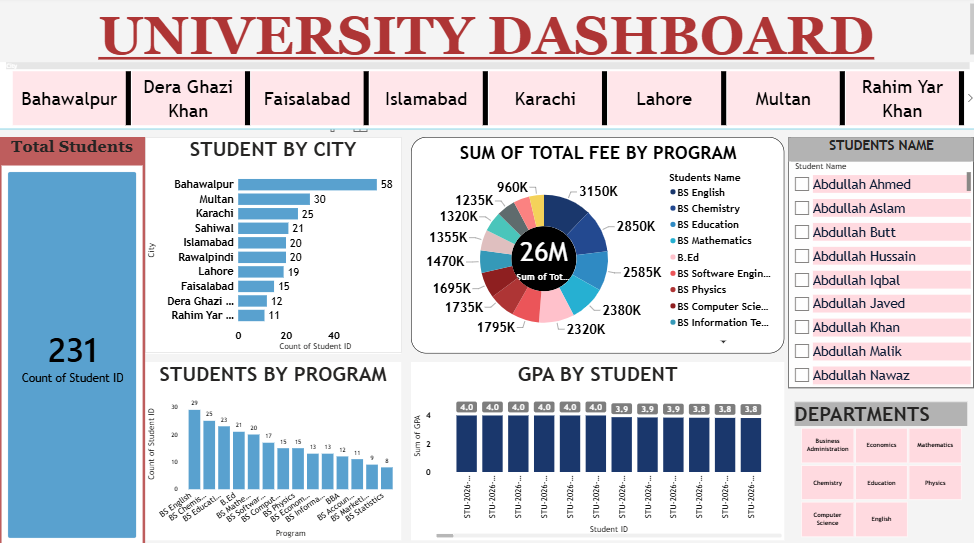

# 🎓 University Analytics Dashboard — Power BI

## 📌 Project Overview
This project presents a University Analytics Dashboard built using Microsoft Power BI. It provides an interactive view of student data to support data exploration and reporting.

## 🎯 Project Objectives
- Analyze student records.
- Explore student distribution by city.
- Present key student metrics.
- Create clear and interactive data visualizations.

## 📊 Dashboard Features
- Total Student Count
- Student Distribution by City
- Interactive Report Visuals
- Clear KPI Presentation

## 🛠️ Tools & Skills
- Microsoft Power BI
- Power Query
- Data Cleaning & Transformation
- Data Modeling
- Data Visualization
- Dashboard Design

## 🖼️ Dashboard Preview
<!-- Replace university-dashboard.png with your actual screenshot filename -->

## 📚 What I Learned
Through this project, I practiced transforming data, working with related tables, and presenting student information through an interactive dashboard.

## 👨‍💻 Author
**Taimoor Rafiq**

[GitHub Profile](https://github.com/taimoorrafiqofficial)

---

*Continuously learning and building practical Data Analytics projects.*
